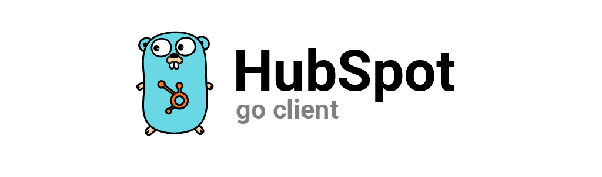

# go-hubspot (Phocas fork)

A HubSpot Go client generated with [openapi-generator](https://github.com/OpenAPITools/openapi-generator).

This is a **fork** of [`clarkmcc/go-hubspot`](https://github.com/clarkmcc/go-hubspot),
maintained by Phocas. It was created because upstream appears unmaintained and still
targeted HubSpot's legacy `v3` APIs via a spec catalog endpoint that now returns 404.

HubSpot has moved to **date-based API versioning** (`/YYYY-MM/`, e.g. `2026-09`) and the
legacy semantic versions (v1–v4) become **unsupported in September 2027**. This fork
regenerates the clients against the current catalog and the `2026-09` specs.

## What's generated

Clients are generated per API into `generated/<version>/<package>`, e.g.
`generated/2026-09/contacts`. The current build targets the **CRM-core** surface:

```
contacts  companies  deals  tickets  products  lineitems  quotes
pipelines properties owners objects (custom objects) associations schemas
```

To add more APIs, extend the `targetAPIs` allowlist in `cmd/generate/main.go` and
re-generate — the generator derives collision-free method names automatically (see
"Re-generating").

## Installing

The module path is still `github.com/clarkmcc/go-hubspot`. To consume this fork, add a
`replace` directive in your `go.mod`:

```go
require github.com/clarkmcc/go-hubspot v0.0.0

replace github.com/clarkmcc/go-hubspot => github.com/phocassoftware/go-hubspot <commit-or-tag>
```

```shell
go mod tidy
```

## Using the clients

Each API is its own package under `generated/<version>/`. Construct a client, build a
request, and execute it:

```go
import (
	"context"

	hubspot "github.com/clarkmcc/go-hubspot"
	"github.com/clarkmcc/go-hubspot/generated/2026-09/contacts"
)

// Authorize with a private-app token (see Authorization below).
authorizer := hubspot.NewTokenAuthorizer("<PRIVATE APP TOKEN>")
ctx := hubspot.WithAuthorizer(context.Background(), authorizer)

client := contacts.NewAPIClient(contacts.NewConfiguration())

// Create a contact.
input := contacts.NewSimplePublicObjectInputForCreate(
	nil, // associations
	map[string]string{
		"firstname": "Adrian",
		"lastname":  "Mott",
	},
)
obj, resp, err := client.BasicAPI.
	PostContacts(ctx).
	SimplePublicObjectInputForCreate(*input).
	Execute()
```

### Method naming

Services are grouped by the spec's tags (`BasicAPI`, `BatchAPI`, `SearchAPI`,
`AdvancedAPI`). Method names come from the generator (see `cmd/generate/main.go`):

- A small set of **stable, ergonomic names** is pinned via `nameOverrides`, e.g.
  `SearchAPI.Search`, `BatchAPI.BatchCreate` / `BatchUpdate` / `BatchArchive` /
  `BatchRead` on contacts and custom objects, and `BasicAPI.GetLabels` on associations.
- All other operations get a generic, collision-free name derived from the HTTP verb
  and path (e.g. `BasicAPI.GetContactsByContactId`, `SearchAPI.PostCompaniesSearch`).

> Note (associations): the legacy `/types` read no longer exists in date-based versions.
> Association type IDs are now read from `/labels` via `BasicAPI.GetLabels`; read
> `typeId` from the response.

## Authorization

Authorization is applied per request via a context value. A private-app token
implementation is provided (HubSpot has sunset API keys).

```go
authorizer := hubspot.NewTokenAuthorizer("<PRIVATE APP TOKEN>")
ctx := hubspot.WithAuthorizer(context.Background(), authorizer)
// Pass ctx to your HubSpot API requests.
```

Under the hood, generated clients call `hubspot.ApplyAuthorizerFromContext` in
`prepareRequest`, which applies any `hubspot.Authorizer` found on the context.

## Re-generating clients

The generator (`cmd/generate/main.go`) fetches HubSpot's public spec catalog
(`https://api.hubspot.com/public/api/spec/v2/specs`), selects the `targetVersion`
release (`2026-09`) for each API in the `targetAPIs` allowlist, rewrites operation IDs
into clean Go method names, and runs `openapi-generator`.

Prerequisites:

- `openapi-generator` on your `PATH` (e.g. the `openapi-generator-cli` jar wrapped in a
  shell script; requires a JDK).
- Go (see `go.mod` for the minimum version).

Then:

```shell
go generate
```

The generator also post-processes the output: it injects the shared authorizer into each
`client.go`, removes generator test stubs, and runs `gofmt`. It only rewrites the version
it generated (`generated/<targetVersion>`), leaving other version trees untouched.

To change the target version, set `targetVersion` in `cmd/generate/main.go` to a newer
date-based release (e.g. a future `YYYY-MM`) and re-generate.
